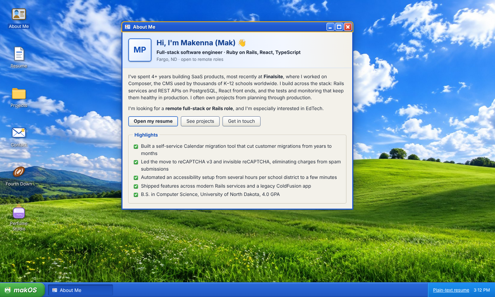

# makOS

**Makenna Peters' portfolio, built as a retro desktop OS.** Each project opens as an app in its own window, and you can drag, resize, minimize and maximize them, or use the whole thing from the keyboard.



<!-- TODO: add a short GIF of dragging/resizing windows here (docs/demo.gif) -->

**Live:** _coming soon on Vercel_ · **Plain-text resume:** [`/resume.txt`](public/resume.txt)

## What's inside

- **A hand-built window manager.** Open, close, focus/z-order, minimize, maximize and restore, drag, and resize from all 8 edges and corners. It uses plain pointer events (with pointer capture and one update per animation frame) and no window library.
- **State in one Zustand store** (`src/store/windows.ts`), with pure, unit-tested geometry: cascading new windows, clamping so a title bar can never be lost off-screen, and re-clamping when the browser resizes.
- **Taskbar** with a start menu, a button for each open window (click to focus, click again to minimize) and a clock.
- **Short, skippable boot screen** that only plays once per browser session.
- **Mobile layout:** below 700px wide (or 500px tall, like a phone in landscape) the desktop becomes a phone-style launcher where apps open as full-screen sheets.
- **Live Fargo, ND weather** in the taskbar tray (and the phone status bar), from [Open-Meteo](https://open-meteo.com/) (no API key), refreshed every 15 minutes.
- **Original look:** inspired by early-2000s desktops. Every style and icon is hand-made, the wallpaper was generated with Canva's AI image tool, and there are no third-party OS assets.

### Accessibility

- Desktop icons use a roving tabindex (one Tab stop, arrow keys between icons, Enter to open).
- Windows are labelled `dialog`s. Focus moves into a window when it opens and goes back to whatever opened it when it closes.
- <kbd>Esc</kbd> closes the active window, <kbd>Alt</kbd>+<kbd>Arrows</kbd> moves it and <kbd>Alt</kbd>+<kbd>Shift</kbd>+<kbd>Arrows</kbd> resizes it.
- The start menu follows the WAI-ARIA menu pattern, and project windows use the tabs pattern.
- Visible focus styles, a skip link, and support for `prefers-reduced-motion`.
- axe-core checks run in CI on both desktop and mobile layouts.

### Recruiter-friendly

- The About window opens on load.
- A resume (PDF) shortcut is always visible in the taskbar tray, plus a plain-text `resume.txt` (in the start menu) and an `llms.txt` for AI agents.
- Open Graph and meta tags for nice link previews.

## Tech stack

| | |
| --- | --- |
| App | React 19, TypeScript, Vite |
| State | Zustand |
| Styling | Plain CSS with custom properties (`src/styles/theme.css`) |
| Unit tests | Vitest + React Testing Library |
| End-to-end + a11y | Playwright + @axe-core/playwright |
| CI | GitHub Actions: lint, type check, unit tests, build, e2e |
| Hosting | Vercel (static) |

## Project structure

```text
src/
  apps/         window contents (About, Resume, Contact, Projects, ProjectWindow)
  components/   desktop shell (Window, Desktop, Taskbar, StartMenu, BootScreen, MobileLauncher, Tabs, Icons)
  data/         app registry, resume and project content
  hooks/        useDragResize (pointer drag/resize), useMediaQuery
  store/        windows.ts (Zustand store), actions.ts (focus management)
  styles/       theme, desktop, window, apps, mobile
e2e/            Playwright specs with axe checks
public/         wallpaper.jpg (+ mobile size), favicon, resume.pdf, resume.txt, llms.txt, og-image.png
```

### Adding an app

1. Add an id and metadata to `APPS` in `src/data/apps.ts` (and to `DESKTOP_APPS` to show an icon).
2. Create the component in `src/apps/` and register it in `src/apps/registry.tsx`.

## Running locally

```bash
npm install
npm run dev          # http://localhost:5173
npm test             # unit tests
npx playwright install chromium
npm run test:e2e     # end-to-end + accessibility
npm run check        # lint + typecheck + tests + build (what CI runs)
```

Commit the `package-lock.json` that `npm install` creates. CI uses `npm ci`, which needs it.

## Deploying

Import the repo in Vercel. It detects Vite automatically (build: `npm run build`, output: `dist`). Add the custom domain in Vercel once it's bought.

## License

Code is MIT. Icons and resume content are © Makenna Peters. The wallpaper was generated with Canva.
