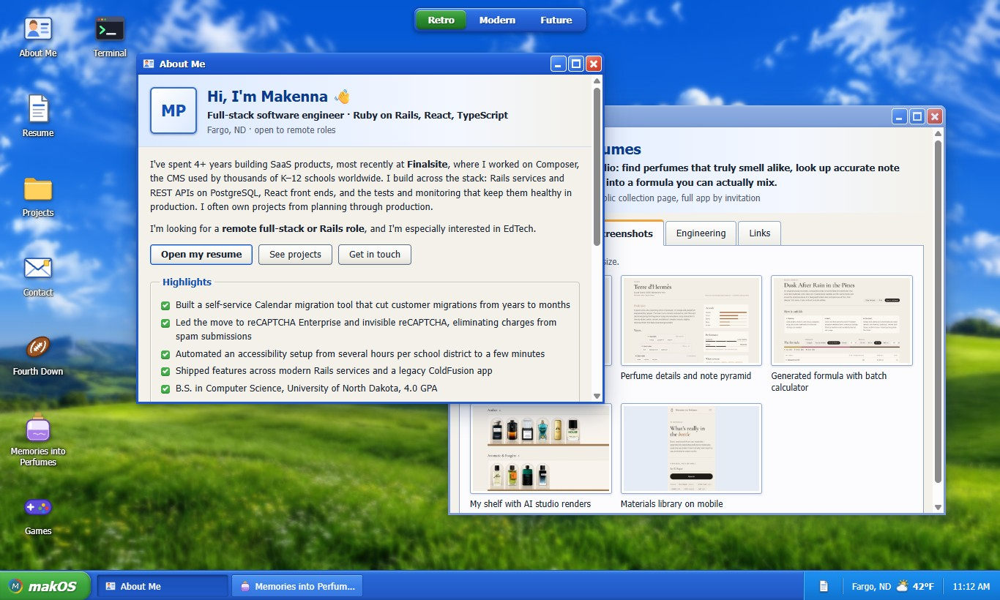
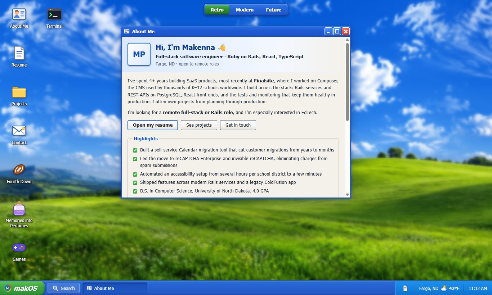
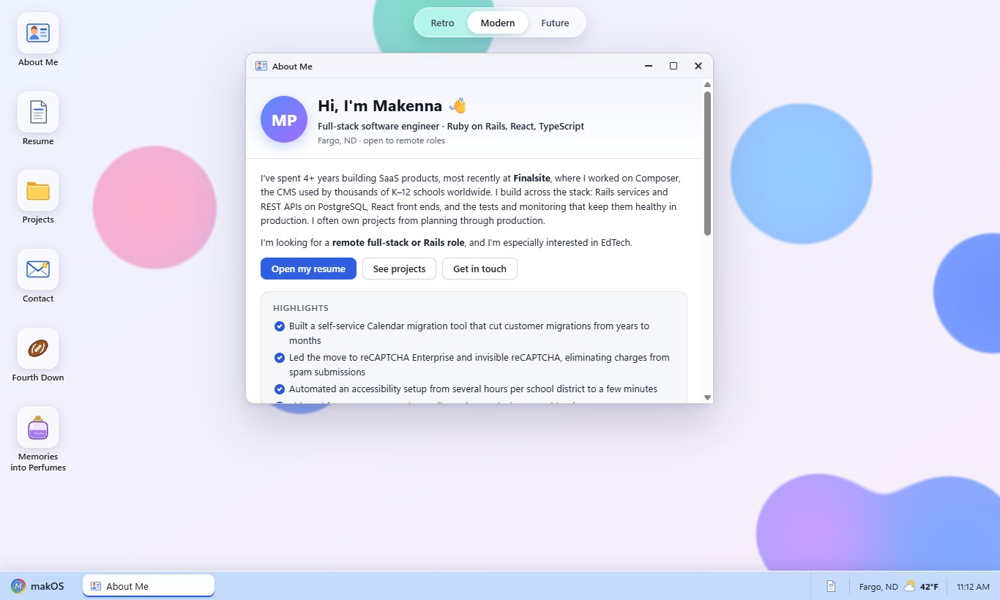
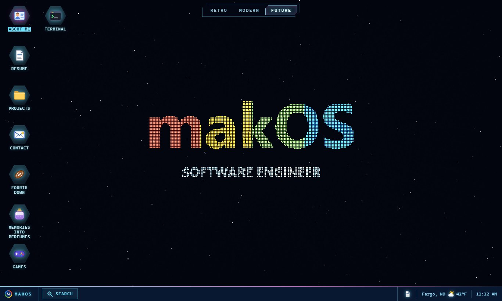

# makOS

[](https://github.com/makenna615/makOS/actions/workflows/ci.yml)

**My portfolio, built as a desktop OS.** Each project opens as an app in its own window, and you can drag, resize, minimize and maximize them, or use the whole thing from the keyboard. Switch between three themes (Retro, Modern and Future), each with its own animated wallpaper. Built using Claude Code.

**Live:** [mak-os-portfolio.vercel.app](https://mak-os-portfolio.vercel.app) · **Resume:** [PDF](public/resume.pdf) · [plain text](public/resume.txt)



## Themes

A switch at the top of the screen changes the whole desktop between three looks. The choice is remembered for next time, and on a first visit the switch points itself out once with a short pulse and tooltip.

- **Retro** (the default): the original early-2000s look. The wallpaper photo is softly blurred, and its own clouds drift slowly across the sky, with faint cloud shadows and a breeze in the grass.
- **Modern**: frosted glass, rounded windows and a light, clean layout. Soft pastel blobs drift and merge like a lava lamp; one follows your mouse, and clicking (or tapping) empty space adds another.
- **Future**: dark neon panels and monospace type. Thousands of particles in the logo's colors spell out "makOS"; move the mouse through them to scatter them and they spring back, or tap to send a shockwave through them.

Each theme has its own transition (a CRT squeeze, a white fade, a scanline flash) and its own boot screen (the original loading bar, a frosted-glass logo with a spinner, a terminal log that types itself out), and every app window is restyled to match.

| Retro | Modern | Future |
| --- | --- | --- |
|  |  |  |

## What's inside

- **A hand-built window manager.** Open, close, focus/z-order, minimize, maximize and restore, drag, and resize from all 8 edges and corners. It uses plain pointer events (with pointer capture and one update per animation frame) and no window library.
- **State in one Zustand store** (`src/store/windows.ts`), with pure, unit-tested geometry: cascading new windows, clamping so a title bar can never be lost off-screen, and re-clamping when the browser resizes.
- **Taskbar** with a start menu, a button for each open window (click to focus, click again to minimize), and a tray with a resume shortcut, live weather and a clock.
- **Project windows** with Overview, Features, Screenshots, Engineering and Links tabs for [Fourth Down](https://github.com/makenna615/fantasy-football-app) and [Memories into Perfumes](https://github.com/makenna615/perfume-app).
- **Live Fargo, ND weather** in the tray and the phone status bar, from [Open-Meteo](https://open-meteo.com/) (no API key), refreshed every 15 minutes.
- **Short, skippable boot screen** that only plays once per browser session.
- **Mobile layout:** below 700px wide (or 500px tall, like a phone in landscape) the desktop becomes a phone-style launcher where apps open as full-screen sheets.
- **Three themes** with animated wallpapers (see above).
- **Original look:** inspired by early-2000s desktops. Every style and icon is hand-made, the wallpaper was generated with Canva's AI image tool, and there are no third-party OS assets.

## Engineering decisions

- **No window library.** Dragging and resizing use pointer capture, and pointer moves are coalesced into one store update per animation frame, so it stays smooth on slow machines. The geometry (resize math, clamping, cascading) is pure functions with unit tests.
- **Focus management is part of the design.** Opening a window moves keyboard focus into it; closing it sends focus back to whatever opened it (an icon, a menu item, a button). Minimizing sends focus to the window's taskbar button.
- **Accessibility is tested, not assumed.** axe-core runs in CI against both the desktop and mobile layouts, alongside Playwright tests for drag, resize, tabs and focus return.
- **Tests never depend on the network.** Unit tests stub `fetch`, and end-to-end tests serve canned weather responses, so CI can't fail because a third-party API is slow or down. If the weather service is unavailable in production, the tray just shows "Fargo, ND".
- **Fast first paint.** The wallpaper is preloaded so it downloads during the boot screen, phones on high-density screens get the full-size image, and project screenshots load lazily as small thumbnails.
- **Animated wallpapers that stay light.** Retro and Modern are WebGL fragment shaders and Future is a 2D canvas, with no libraries or video files. The Retro shader analyses the wallpaper photo once (where the land meets the sky, and the clear-sky color of each row) so it can lift the real clouds off the sky and move them. Animation pauses in background tabs, the blurred Retro scene renders at reduced resolution and 30fps, and visitors with `prefers-reduced-motion` get a still frame. Without WebGL, each theme falls back to a still CSS background.
- **Themes are CSS, not components.** The chosen theme sets `data-theme` on `<html>`, and everything else is styles scoped to it, so the window manager and apps are the same code in every theme. The saved choice is validated before use.
- **Locked-down hosting.** `vercel.json` sets a strict Content Security Policy (scripts and styles only from this site, network calls only to the weather API, no framing) plus other security headers, and long-term caching for fingerprinted assets.

### Accessibility

- Desktop icons use a roving tabindex (one Tab stop, arrow keys between icons, Enter to open).
- Windows are labelled `dialog`s. Focus moves into a window when it opens and goes back to whatever opened it when it closes.
- <kbd>Esc</kbd> closes the active window, <kbd>Alt</kbd>+<kbd>Arrows</kbd> moves it and <kbd>Alt</kbd>+<kbd>Shift</kbd>+<kbd>Arrows</kbd> resizes it.
- The start menu follows the WAI-ARIA menu pattern, and project windows use the tabs pattern.
- Every screenshot has a written description, and icon labels stay readable over the wallpaper.
- The theme switch is a radio group (one Tab stop, arrow keys to change theme), and axe runs against every theme in CI.
- Visible focus styles, a skip link, and support for `prefers-reduced-motion`.

### Recruiter-friendly

- The About window opens on load.
- A resume (PDF) shortcut is always visible in the taskbar tray, plus a plain-text `resume.txt` (in the start menu) and an `llms.txt` for AI agents.
- Open Graph and meta tags for link previews.

## Tech stack

| | |
| --- | --- |
| App | React 19, TypeScript, Vite |
| State | Zustand |
| Styling | Plain CSS with custom properties (`src/styles/theme.css`), themes scoped by `data-theme` |
| Wallpapers | WebGL shaders and 2D canvas, no libraries |
| Unit tests | Vitest + React Testing Library |
| End-to-end + a11y | Playwright + @axe-core/playwright (desktop and mobile) |
| CI | GitHub Actions: lint, type check, unit tests, build, e2e |
| Hosting | Vercel (static, with security headers in `vercel.json`) |

## Project structure

```text
src/
  apps/         window contents (About, Resume, Contact, Projects, ProjectWindow)
  components/   desktop shell (Window, Desktop, Taskbar, StartMenu, BootScreen, MobileLauncher, Tabs, Icons, Weather,
                ThemeSwitch, Wallpaper)
  data/         app registry, resume and project content, weather codes
  hooks/        useDragResize (pointer drag/resize), useMediaQuery, useWeather
  store/        windows.ts (Zustand store), actions.ts (focus management)
  theme/        theme.ts (current theme and saved choice)
  wallpaper/    animated wallpapers (retroSky, liquidBlobs, particleName) and shared WebGL/canvas helpers
  styles/       theme, desktop, window, apps, mobile, themes (Modern and Future chrome), themes-apps (window contents)
e2e/            Playwright specs with axe checks
public/         wallpaper, project screenshots, resume (PDF + text), llms.txt, og-image, favicon
docs/           README screenshots (desktop and one per theme)
```

### Adding an app

1. Add an id and metadata to `APPS` in `src/data/apps.ts` (and to `DESKTOP_APPS` to show an icon).
2. Create the component in `src/apps/` and register it in `src/apps/registry.tsx`.

## License

The source code is [MIT](LICENSE). The resume content, icons and project screenshots are © Makenna Peters, and the wallpaper was generated with Canva.
